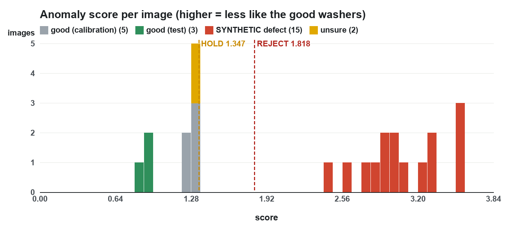

# NAZAR vision: evaluation report

*Generated by `python -m nazar_vision.evaluate` on 2026-11-02 14:05:47 (model trained 2026-11-02 14:05:44). Rerun `./retrain.sh` after recapturing and this file is rewritten.*

## In short

- **Held-out good washers:** 3 of 3 PASS, 0 HOLD, 0 REJECT. Only 3 independent good test photos exist, so this says little yet.
- **SYNTHETIC defects (drawn on, not real):** 15 of 15 REJECT, 0 HOLD, 0 PASS. This shows the pipeline reacts to a changed outline or face; it is not an accuracy figure for real damage.
- **REAL defects, held out: none.** No photo of a real damaged washer exists yet.
- **Synthetic no-washer frames:** 5 of 5 NO_PART (never a defect).
- **Speed:** median 47.3 ms, p95 54.7 ms per inspection (after JPEG decode) on the Mac mini M4 CPU. Target < 150 ms.

## Data and split

Images used: first set + capture.

Split by **placement** (a washer lying in one spot, photographed several times), not by photo, so a test photo is never a near-copy of a training photo. Byte-identical files are dropped. Placements: 3 train, 3 calibration, 3 test.

| Set | Photos | Used for |
|---|---|---|
| Train | 18 | memory bank (x 12 rotations, brightness +-10 %) |
| Calibration | 5 | HOLD line |
| Test, good | 3 | confusion matrix |
| REAL defects for REJECT line | 0 | REJECT line |
| Test, REAL defects | 0 | confusion matrix |
| Real empty belt | 0 | must give NO_PART |
| Unsure | 2 | reported only |

## Model and thresholds

- WideResNet50-2 (ImageNet) layer2 + layer3 patch features, 3x3 averaged, projected to 512-d, 28 x 28 grid.
- Memory bank: 152,064 patches from 18 photos -> greedy k-center coreset of **15,206** patches.
- Only the ring is scored: mask to 1.04 x rim radius, hole middle ignored up to 0.7 x hole radius. Image score = max of the Gaussian-blurred (sigma 4) map.
- **HOLD = 1.3470**: conformal: score rank 5 of 5 calibration photos (alpha 0.1) = the largest, too few photos for a tighter rule.
- **REJECT = 1.8184**: hold x 1.35 (no real defect photos yet).
- Calibration scores: 1.220, 1.221, 1.296, 1.315, 1.347.

## Confusion matrix

Rows: what the image is. Columns: the verdict.

| | PASS | HOLD | REJECT | NO_PART | n |
|---|---|---|---|---|---|
| good (test) | 3 | 0 | 0 | 0 | 3 |
| good (calibration, not independent) | 5 | 0 | 0 | 0 | 5 |
| **SYNTHETIC** defect (drawn on) | 0 | 0 | 15 | 0 | 15 |
| no part (synthetic) | 0 | 0 | 0 | 5 | 5 |
| unsure | 2 | 0 | 0 | 0 | 2 |

## Every image

*Distance to train* = how far the washer centre is from the nearest training placement, in washer radii. A good test photo lying where a training washer lay is an easier test than one somewhere new on the belt.

| Set | Image | Verdict | Score | Distance to train |
|---|---|---|---|---|
| good (test) | Photo-20.jpeg | PASS | 0.896 | 0.02 r |
| good (test) | Photo-75.jpeg | PASS | 0.835 | 0.00 r |
| good (test) | Photo-91.jpeg | PASS | 0.901 | 0.00 r |
| good (calibration) | Photo-1.jpeg | PASS | 1.296 | 0.05 r |
| good (calibration) | Photo-10.jpeg | PASS | 1.315 | 0.02 r |
| good (calibration) | Photo-12.jpeg | PASS | 1.221 | 0.26 r |
| good (calibration) | Photo-6-2.jpeg | PASS | 1.347 | 0.03 r |
| good (calibration) | Photo-8.jpeg | PASS | 1.220 | 0.02 r |
| SYNTHETIC defect / burr | SYNTH-burr-Photo-20.jpg | REJECT | 2.582 |  |
| SYNTHETIC defect / burr | SYNTH-burr-Photo-75.jpg | REJECT | 2.450 |  |
| SYNTHETIC defect / burr | SYNTH-burr-Photo-91.jpg | REJECT | 2.908 |  |
| SYNTHETIC defect / crack | SYNTH-crack-Photo-20.jpg | REJECT | 3.237 |  |
| SYNTHETIC defect / crack | SYNTH-crack-Photo-75.jpg | REJECT | 3.317 |  |
| SYNTHETIC defect / crack | SYNTH-crack-Photo-91.jpg | REJECT | 3.294 |  |
| SYNTHETIC defect / notch | SYNTH-notch-Photo-20.jpg | REJECT | 3.064 |  |
| SYNTHETIC defect / notch | SYNTH-notch-Photo-75.jpg | REJECT | 2.987 |  |
| SYNTHETIC defect / notch | SYNTH-notch-Photo-91.jpg | REJECT | 2.741 |  |
| SYNTHETIC defect / scratch | SYNTH-scratch-Photo-20.jpg | REJECT | 2.849 |  |
| SYNTHETIC defect / scratch | SYNTH-scratch-Photo-75.jpg | REJECT | 2.893 |  |
| SYNTHETIC defect / scratch | SYNTH-scratch-Photo-91.jpg | REJECT | 2.990 |  |
| SYNTHETIC defect / spot | SYNTH-spot-Photo-20.jpg | REJECT | 3.551 |  |
| SYNTHETIC defect / spot | SYNTH-spot-Photo-75.jpg | REJECT | 3.556 |  |
| SYNTHETIC defect / spot | SYNTH-spot-Photo-91.jpg | REJECT | 3.537 |  |
| no part (synthetic) | SYNTH-nopart-Photo-20.jpg | NO_PART | - |  |
| no part (synthetic) | SYNTH-nopart-Photo-75.jpg | NO_PART | - |  |
| no part (synthetic) | SYNTH-nopart-Photo-91.jpg | NO_PART | - |  |
| no part (synthetic) | SYNTH-nopart-belt-zoom.jpg | NO_PART | - |  |
| no part (synthetic) | SYNTH-nopart-grey.jpg | NO_PART | - |  |
| unsure | Photo-16.jpeg | PASS | 1.286 |  |
| unsure | Photo-17.jpeg | PASS | 1.284 |  |

## Speed (CPU only)

Full inspection after decoding (find washer, crop, backbone, nearest-neighbour search, heatmap, two PNGs): **median 47.3 ms, p95 54.7 ms**, max 58.2 ms over 30 images.

| Step | Median ms |
|---|---|
| decode | 4.8 |
| find washer | 2.9 |
| crop | 0.1 |
| backbone | 25.4 |
| nearest neighbour | 11.7 |
| map + PNGs | 2.4 |

## What is NOT verified

- **REAL defects.** None photographed yet; every defect number above is synthetic.
- **The first photo set is weak:** the washer face is overexposed (pure white), so real scratches or rust may be invisible to the camera; most placements sit at the same spot on the belt; many files were byte-identical copies.
- **Few independent good tests** (3). The false-HOLD rate cannot be estimated well from that.
- **The good test is easier than it looks:** the test washers lie a median 0.00 washer radii from a training placement and score lower than the calibration washers (0.03 radii away). A washer somewhere new on the belt scores higher, closer to HOLD.
- **The real camera at belt speed** (motion blur, exposure drift) was not tested here.

## Fix on site

1. Lower exposure or light until the washer face is grey, not white.
2. Capture 40+ good washers through the console (each a different washer or a new spot), and every real damaged washer you have, with its kind (`/capture?label=defect&kind=scratch`).
3. `./retrain.sh` (about a minute), then read this report again.
