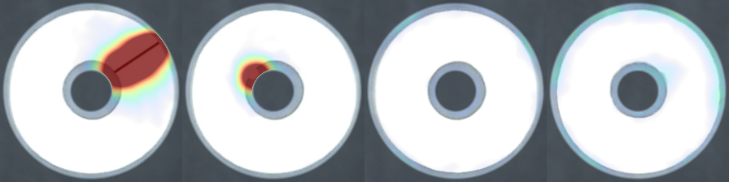
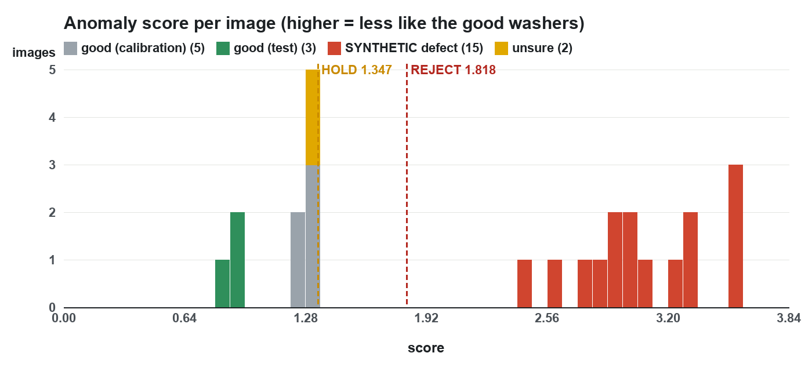

# Vision AI — Washer Inspection

> How NAZAR looks at each washer, decides PASS, HOLD or REJECT in about 50 ms on the Mac's CPU, and what is still not proven.

## 1. What this part does

The conveyor stops every washer under the camera. The NAZAR console takes a photo and sends it to a small program on
the same Mac, the **vision service**. Within about 50 milliseconds the service answers with:

- a **verdict**: PASS (good), HOLD (not sure, a person should look), REJECT (damaged), or NO_PART (no washer in the photo);
- a **score**: how different this washer looks from the good washers it has seen (higher = more different);
- the **crop** (the washer cut out of the photo) and a **heatmap** that colours the spot that looks wrong.

The console turns the verdict into a command for the ESP32: PASS lets the part go, REJECT fires the gate, HOLD stops
the line for the operator. NO_PART is never treated as a defect.

Everything runs on the Mac with no internet: no cloud service, no GPU, no account.

## 2. Anomaly detection, not classification

There are two ways to teach a computer to spot bad parts.

**Classification** shows it many examples of every class ("good", "scratch", "burr", "rust") and it learns to tell
them apart. That needs hundreds of photos of each kind of damage. A factory rarely has them: damaged parts are rare,
and the next defect may be a kind nobody photographed.

**Anomaly detection** shows it only good parts. It learns what "normal" looks like and flags anything that does not
fit, whatever kind of damage it is. Good washers are easy to collect (every washer on the line), and a new type of
damage still stands out. NAZAR uses anomaly detection.

The price: the model cannot name the defect. It only says "this spot is unusual, this much". That is enough to
reject a part, and the heatmap shows the operator where to look.

## 3. The steps of one inspection

```
photo -> find washer -> square crop 224 x 224
      -> backbone (ONNX) -> 784 patch vectors
      -> distance of each patch to the nearest good patch -> anomaly map
      -> score = hottest point of the ring
      -> PASS (score <= HOLD) / HOLD / REJECT (score >= REJECT)
```

| Step | Typical time on the Mac mini M4 |
|---|---|
| Decode the JPEG | 5 ms |
| Find the washer (OpenCV) | 3 ms |
| Backbone network (ONNX Runtime, CPU) | 26 ms |
| Nearest-neighbour search (numpy) | 12 ms |
| Heatmap and the two PNG pictures | 2 ms |
| **Whole request over HTTP** | **50 ms median, 53 ms p95** |

## 4. Finding the washer (OpenCV)

OpenCV is a free library of classic image-processing tools. No learning is involved in this step.

1. The photo is shrunk to 640 px wide (faster) and turned grey.
2. **Candidate centres.** The Hough circle transform votes for circles in the edges of the image. Each edge pixel votes
   for all the circle centres it could belong to; centres with many votes win. If Hough finds nothing, the largest round
   blob after an automatic (Otsu) threshold is used instead.
3. **Exact centre.** From a candidate centre, 96 rays go outwards like spokes of a wheel. On each ray, the outermost
   strong brightness step is taken as a point of the rim. A circle is fitted to those points by least squares, rays that
   disagree (a rail, a notch) are dropped, and the fit is repeated.
4. **Rim and hole.** Along the rays, the brightness profile shows two steps that go all the way round: the outer rim and
   the hole. Hough alone often picks the hole, because it keeps only one circle per centre; this radial search fixes that.
5. **Is it really a washer?** The rim must be a clear edge, the ring must be clearly brighter than the belt (by about 30
   grey levels; the training washers were 84 brighter), its size must be within 0.6-1.6 times the training washers, and
   it must not be cut by the edge of the frame. Otherwise the answer is NO_PART.

The washer is then cut out as a square with 8 % margin around the rim and resized straight to 224 x 224 pixels.
(The usual "resize to 256, cut the middle 224" recipe would cut the rim off, and the rim is where chips and notches are.)

### The ring mask

Only the **ring** is scored. Outside the rim and in the middle of the hole the camera sees the belt, and the belt
looks different every time a washer lands in a new spot. In the first version of NAZAR, the belt seen through the hole
was the "most unusual" thing on good washers. So the score ignores everything beyond 1.04 times the rim radius and
inside 0.7 times the hole radius. The hole **edge** is still scored, so a burr in the hole still counts.

## 5. The backbone: WideResNet50 and ImageNet features

A **convolutional neural network** (CNN) turns an image into feature maps: grids of numbers that describe what is at
each place (edges, corners, textures, small shapes). **WideResNet50-2** is a well-known CNN with 50 layers. It was trained
by the PyTorch team on **ImageNet**, 1.2 million photos of 1,000 kinds of everyday objects. It never saw a washer, but
learning to recognise so many objects taught it general visual features that work on almost anything.

NAZAR does not retrain this network. It only reads two of its middle layers:

- **layer2**: a 28 x 28 grid, 512 numbers per cell. Fine detail: edges, scratches, small texture.
- **layer3**: a 14 x 14 grid, 1,024 numbers per cell. Larger shapes. It is enlarged to 28 x 28 to match layer2.

Each cell is averaged with its 3 x 3 neighbours (so a patch knows a little about its surroundings), the two layers are
joined (1,536 numbers per cell), and a fixed random projection squeezes that to **512 numbers**. A random projection keeps
distances between vectors nearly the same while making everything 3 times smaller and faster.

Result: each crop becomes **784 patch vectors** (28 x 28), each describing about an 8 x 8 pixel area of the washer.

## 6. ONNX and ONNX Runtime: why offline and CPU

The network is written in PyTorch, which is a large install (gigabytes) and is meant for training. NAZAR only needs to
**run** the network. So it was exported once to **ONNX** (Open Neural Network Exchange), a standard file format that
stores the layers and weights: `models/backbone.onnx`, 103 MB.

**ONNX Runtime** (from Microsoft) is a small, fast engine that runs ONNX files on the CPU. The service needs only
ONNX Runtime, numpy, OpenCV and Pillow. Reasons:

- **Offline:** no internet at the venue is needed and no data leaves the Mac.
- **CPU is fast enough:** about 26 ms for the network; the whole inspection is about 50 ms, well inside the line's
  1.2 s stop time.
- **Small and simple to set up** on any Mac, with no GPU drivers.

The export (`nazar_vision/export.py`) is the only step that needs PyTorch; it was checked to give the same numbers as
PyTorch (largest difference 0.0000016).

## 7. The memory bank and the coreset

Training is not "learning weights". It is **collecting examples**:

1. Every good training photo is cropped, then turned 12 times (every 30 degrees) with the brightness changed by up to
   ±10 %. A washer can lie at any angle and the light drifts, and this teaches the bank both.
2. All patch vectors of all those crops are collected: 152,064 of them from 18 photos.
3. Most are near-copies of each other. A **greedy k-center coreset** keeps 10 %: start with one patch, then repeatedly
   add the patch that is **farthest** from everything already kept. This keeps every kind of normal patch (rim, face, hole
   edge at every angle) while dropping repeats. The result is **15,206 patches**, the **memory bank** (16 MB).

## 8. The score: nearest-neighbour distance and the heatmap

For a new washer, each of its 784 patches is compared with all 15,206 patches in the bank, and the **distance to the
nearest one** is kept. A patch of a normal ring finds a close match (small distance). A patch on a scratch, a chip or a
rust spot finds nothing similar (large distance).

The 28 x 28 distances are enlarged to 224 x 224, smoothed with a Gaussian blur (sigma 4 pixels, so one noisy patch does
not decide alone), and multiplied by the ring mask. That is the **anomaly map**. The **score** is its hottest point.

The **heatmap** colours the map over the crop: nothing below 60 % of HOLD, rising through blue, yellow and red, full
red at REJECT. The area outside the ring is greyed out because it is not scored.



The search is plain numpy matrix maths: distance squared = |a|² − 2a·b + |b|², done in blocks of 8,192 bank patches
so memory stays small. About 12 ms.

## 9. Thresholds: PASS, HOLD, REJECT

Two lines split the score into three verdicts:

- score up to **HOLD**: PASS;
- between HOLD and **REJECT**: HOLD, a person decides;
- **REJECT** or more: REJECT, the gate fires.

**HOLD comes from conformal calibration.** Some good photos are kept out of training (the calibration set). Their
scores show how high a *good* washer can score. With n calibration scores, HOLD is the ⌈(n+1)·0.9⌉-th smallest.
Conformal prediction guarantees that a new good washer from the same conditions scores above that with a probability
of at most 10 %. With only 5 calibration photos the rule picks the largest of the 5 (1.347): there are too few photos
for anything tighter, so the guarantee is weak until more good washers are captured.

**REJECT** is set halfway between HOLD and the lowest score of real damaged washers kept for this. There are none yet, so
it is HOLD x 1.35 = **1.818**.

The console may override both lines for one request with `?hold=&reject=`.

## 10. The HTTP API

The service is a small web server from Python's standard library, listening only on `127.0.0.1:8765` (this Mac only).
The console talks to it with ordinary HTTP requests (the rules are in `CONTRACT.md` section 4).

| Request | What it does |
|---|---|
| `GET /health` | Is the service up? Model name, HOLD, REJECT, bank size, version 2.0.0. |
| `POST /inspect` with the photo bytes | Verdict, score, crop, heatmap, box `[x, y, w, h]` of the washer. |
| `POST /capture?label=good` or `?label=defect&kind=scratch` | Saves the photo to `data/capture/...` for retraining. |

Every answer is JSON, every error is `{"ok": false, "error": "..."}`, and a bad request never stops the service. Every
answer carries `Access-Control-Allow-Origin: *` because the console page is loaded from a file. For a demo without a
camera, `./run.sh --test-images data/synthetic` swaps each posted frame for the next test photo.

Tested with curl: health, a good photo (PASS), a synthetic notch (REJECT), a frame with the washer removed and a plain
grey PNG (NO_PART), threshold overrides, wrong numbers, a text body, an empty body, a cut-off JPEG, captures, a wrong
label, the OPTIONS pre-flight and an unknown address. All answered correctly and the service stayed up.

## 11. Recording washers with the iPhone and retraining

The first photo set is weak (webcam, overexposed, few placements), so the model will be retrained on iPhone photos
taken at the venue. The iPhone is also the live camera (Continuity Camera in the console), so training and live
images come from the same phone.

### Taking the photos (main path)

1. **Camera app, Photo mode, 1x.** Live Photo OFF, flash OFF.
2. **Keep the same lens.** Settings > Camera > Macro Control ON, then tap the flower icon in the Camera app so macro
   is off. Otherwise the phone may switch to the ultra-wide lens close up and the washer looks different.
3. **Lock and darken.** Long-press the washer for AE/AF LOCK, then drag the sun icon down until the washer face shows
   grey texture, not pure white. A scratch the camera cannot see, the model cannot find.
4. **Same place as the live camera.** Phone fixed at the same height, angle and position as the live camera in the
   light tunnel, tunnel LEDs on, belt stopped.
5. **Good washers:** one washer per photo, moved to a new spot and turned between photos, 6-8 photos per washer,
   30-40 washers.
6. **Damaged washers:** every one photographed on its own, kept apart by kind (scratch, dent, rust, burr, crack,
   chipped, wrong-size, other). A few photos of the **empty belt** too.
7. **AirDrop** them to the Mac.

Videos also work: Video 1080p 30 fps, HDR Video OFF (Settings > Camera > Record Video), the same lock and position,
one washer per clip moved to 6-8 spots and turned, 10-15 s per clip, every damaged washer in its own clip, one
empty-belt clip.

### What ingest does

`./ingest.sh <folder> --label good` (or `--label defect --kind scratch`, or `--label empty`) reads a folder straight
from AirDrop; files can also be sorted into `footage/good`, `footage/defect/<kind>` and `footage/empty`.

- **HEIC** photos are converted with the macOS tool `sips`; for an HDR photo this gives the normal (SDR) picture.
  The EXIF orientation is applied, and the EXIF time says when each photo was taken.
- **Videos**: ffmpeg takes about 4 frames per second, turns the picture upright from the rotation tag, and maps HDR
  (HLG / Dolby Vision) to normal SDR so frames are not grey and flat. Each clip is one placement.
- Every image is scaled so its long side is at most 1920 px, like the live 1920 x 1080 frames.
- An image is **kept** only if exactly one washer is found, fully inside the frame, with a crisp rim. Sharpness is
  measured on the rim edge itself (how steep the step from washer to belt is), so a smooth, well-exposed washer is not
  mistaken for a blurry one.
- **Near-copies** are dropped: two photos less than 2 s apart with the washer in the same spot count as one placement,
  and in a video a frame where the washer has not moved is skipped. At most 12 frames per clip.
- A summary line per photo or clip says what was kept and why the rest was dropped, and warns when the washer face is
  overexposed. Every image is listed in `data/footage/manifest.csv`.

### Retrain

Run **`./retrain.sh`** (1-3 minutes). It ingests, splits by placement, makes synthetic test images, trains, evaluates
and rewrites `REPORT.md`. Real damaged washers now set the **REJECT** line (halfway between HOLD and the lowest real
defect score) and are reported as **REAL**, separately from the synthetic ones. If a power cut stops it, run it again:
finished photos are skipped, and `./retrain.sh train` starts from a later stage. Then restart the service.

The split is **by placement, not by photo**: photos of a washer that was not moved are near-copies, and if one were in
training and its twin in the test, the test would look better than reality.

**Image size does not matter** to the inspection: it finds the washer, crops around it and resizes the crop to
224 x 224. What matters is how big and sharp the washer looks; that is why the phone must sit where the live camera
sits, with the same lens.

### Tested how

No real iPhone file has arrived yet, so the pipeline was tested on **fake** iPhone files made from the first photos:
HEIC photos (including one stored sideways with an EXIF orientation tag, a 48-megapixel one, a burst of three, a blurred
one, one with the washer cut by the frame edge, one with two washers, an empty belt), H.264 videos, an HEVC 10-bit
HDR (HLG) video and a portrait video with a rotation tag. Every case was kept or dropped as intended, the sideways photo
came out upright, the HDR video came out with normal brightness, and the whole `./retrain.sh` ran end to end. The fake
files were then deleted and the model retrained on the first photo set (the numbers below).

## 12. Current numbers (first photo set)

18 training photos (3 placements), 5 calibration (3), 3 test (3). 22 byte-identical copies were removed before this.

| Image set | PASS | HOLD | REJECT | NO_PART |
|---|---|---|---|---|
| Good, held out (3) | 3 | 0 | 0 | 0 |
| Good, calibration (5, they set HOLD) | 5 | 0 | 0 | 0 |
| **SYNTHETIC** damage drawn on the test photos (15) | 0 | 0 | 15 | 0 |
| Washer removed, grey frame, belt only (5) | 0 | 0 | 0 | 5 |
| Unsure, Photo-16/17 (2) | 2 | 0 | 0 | 0 |



The synthetic damage (notch, burr, crack, rust spot, scratch) scores 2.45-3.56, well past REJECT (1.82). Good washers
score 0.83-1.35. Speed: 45 ms median, 52 ms p95 inside the service; 50 ms median over HTTP.

## 13. What is NOT verified

- **No real damaged washer has been tested.** Every defect result above is synthetic: shapes drawn onto good photos.
  Real damage can be much subtler than a drawn line.
- **The camera overexposes the washer face** (pure white) in the first photos. Surface scratches and rust may be
  invisible until the light is fixed.
- **Only 3 good test photos**, and they lie at the same belt spot as training washers (0-2 px away), which makes the test
  easy. Calibration washers further away scored higher (up to 1.35). A false-HOLD rate cannot be measured from this.
- **Photo-16/17** look like a slightly larger washer (rim 4 % bigger) with a possible nick at the hole edge. The model
  passes them (1.28). If that washer is really damaged or the wrong size, this model misses it. The response includes
  `size_ratio` so a size rule could be added, but it was not, because it is untested.
- **The real camera at belt speed** (motion blur, exposure drift, the exact stop position) has not been tested with this
  service.
- **Real iPhone files** have not been ingested yet: the HEIC, HDR and rotation handling was tested on fake files made on
  this Mac. In particular, whether `sips` gives the SDR picture of a real iPhone HDR photo (with its gain map) and the
  right orientation of a real portrait HEIC is checked only with synthetic files; a wrong orientation would not hurt
  the model (it trains on turned copies anyway).
- **Continuity Camera vs the Camera app**: if the live feed uses a different lens or zoom than the photos, the washer
  has a different size and sharpness. The live check accepts 0.5-2 times the training size, but the scores may shift;
  check a few good washers live after retraining.
- Thresholds are set from very few photos and will move after recapture.

## 14. Words used

| Word | Meaning |
|---|---|
| Anomaly detection | Learning only what normal looks like and flagging what is different |
| CNN, backbone | The neural network that turns a picture into feature numbers |
| Patch vector | 512 numbers describing one small square of the washer |
| Memory bank | The stored patch vectors of good washers |
| Coreset | A small subset that still covers all kinds of patches |
| Nearest neighbour | The most similar stored patch |
| Conformal calibration | Setting a threshold from held-out good scores with a probability guarantee |
| ONNX / ONNX Runtime | Standard network file / engine that runs it on the CPU |
| Placement | One washer lying in one spot; all its photos are near-copies |
| Ingest | Turning AirDropped photos and videos into clean one-washer training images |
| HEIC, HLG | Apple's photo format; the HDR video format iPhones record |
